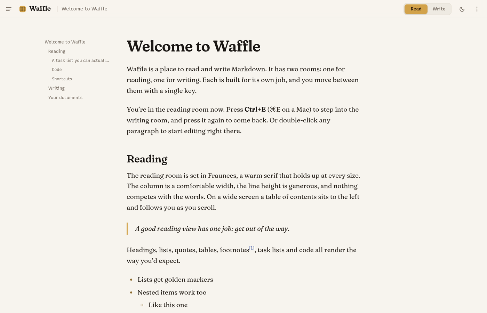
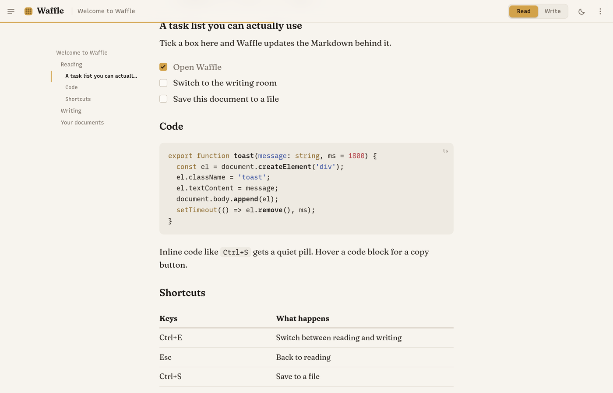
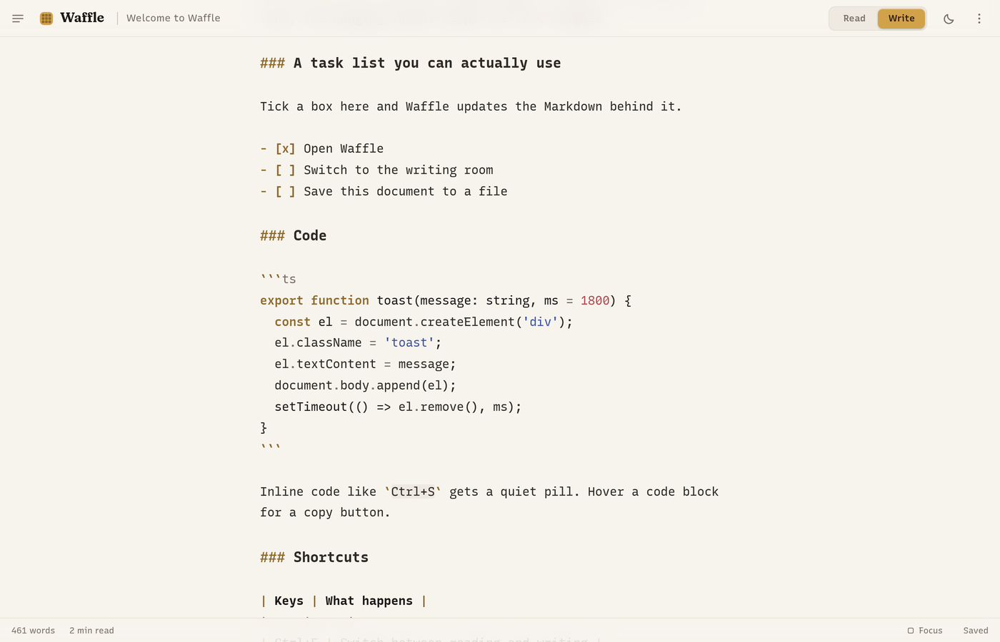
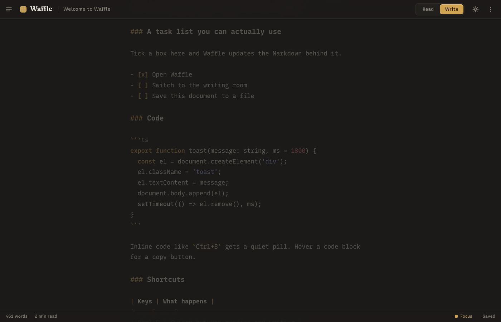
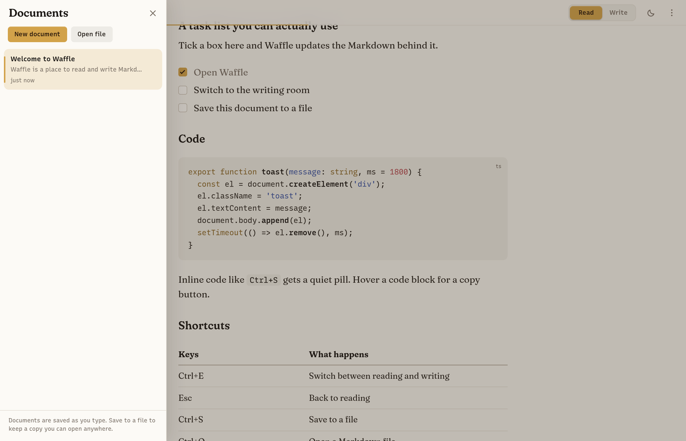

<p align="center">
  
</p>

<h1 align="center">Waffle</h1>

<p align="center">
  A Markdown reader and editor with two rooms: one for reading, one for writing.<br>
  Each is built for its own job, and you move between them with a single key.
</p>

<p align="center">
  <picture>
    <source media="(prefers-color-scheme: dark)" srcset="docs/screenshots/read-dark.png">
    
  </picture>
</p>

## Why

Markdown apps mostly pick one of two shapes. Either you write in a text box with a preview
pane beside it, splitting your attention and your screen, or you get a rich editor that
hides the Markdown and reshapes it under your cursor. Neither is good for reading, and the
second isn't great for writing either.

Waffle keeps the two jobs apart. The reading room is a page: a comfortable column, a warm
serif, nothing else. The writing room is plain text with just enough styling to keep you
oriented. One key moves you between them and keeps your place to the line. The result is a
reader you'd happily spend an hour in, and an editor that never pretends to be a word
processor.

## What it does

**Reads like a book.** The reading room is set in Fraunces at a measure of about 70
characters, with generous leading and headings that get the display cut of the face. On a
wide screen a table of contents sits beside the column, follows you as you scroll, and marks
the section you're in. A thin line under the top bar shows how far through the document you
are. Smart quotes, dashes and ellipses are applied on display and never written to your
file.

**Renders all of it.** Headings, lists, task lists, quotes, tables, footnotes, images with
captions, fenced code with syntax highlighting and a copy button, raw HTML (sanitised), and
links that open in your browser. Horizontal rules are drawn as a row of three waffle
pockets.

**Lets you tick things off while reading.** Task list checkboxes are live. Tick one and the
`[ ]` in your Markdown becomes `[x]`, with nothing else touched.

<p align="center">
  <picture>
    <source media="(prefers-color-scheme: dark)" srcset="docs/screenshots/read-dark-code.png">
    
  </picture>
</p>

**Writes in plain text.** The writing room is a CodeMirror editor in a monospace face, the
same column width as the page so the switch feels like turning over the same sheet.
Headings grow, bold and italic show, links are coloured, fenced code is highlighted in its
own language, and the Markdown punctuation is a muted ochre so it stays legible without
shouting. Enter continues a list, Tab indents it, Ctrl+B, Ctrl+I and Ctrl+K wrap or unwrap
the selection, and Ctrl+F opens find and replace.

<p align="center">
  <picture>
    <source media="(prefers-color-scheme: dark)" srcset="docs/screenshots/write-dark.png">
    
  </picture>
</p>

**Keeps your place.** Switching rooms maps the line at the top of your screen to the same
line on the other side, using the source positions Markdown rendering already knows. When
you come back to reading, the block you were editing glows for a moment so your eye lands on
it. Double-click any paragraph while reading and the editor opens with the cursor on that
line.

**Focus mode.** One switch in the bottom bar dims everything except the paragraph you're in.

<p align="center">
  
</p>

**Saves as you type.** Every document is stored under your app data directory half a second
after you stop typing, together with where you were reading and where your cursor was.
Close the app mid-sentence and the sentence is there when you come back.

**Works with files too.** Open a `.md` file through the dialog or drop one on the window.
Save writes back to the same path; the title shows a dot and the bottom bar says so while a
file has changes that aren't on disk, and closing the window with unsaved changes asks
first. Reopening a file picks up changes made outside Waffle, as long as you haven't edited
your copy in the meantime.

**Keeps a list.** The documents drawer shows everything you've written or opened, newest
first, with a snippet, when you last touched it, and the file it came from. Deleting asks
once, inline. Removing a file-backed document only takes it off the list.

<p align="center">
  
</p>

**Gets it out again.** Export as a standalone HTML page, copy the Markdown, or print the
reading room with a stylesheet made for paper.

**Follows your desktop.** Light and dark themes track the system setting until you pin one.
The window title is the document title.

## Install

Grab the package for your system from the
[Releases](https://github.com/Gingerbreadfork/waffle/releases) page.

```sh
sudo dnf install ./Waffle-*.x86_64.rpm            # Fedora, RHEL, openSUSE
sudo apt install ./Waffle_*_amd64.deb             # Debian, Ubuntu, Mint
chmod +x Waffle_*.AppImage && ./Waffle_*.AppImage # anything else
```

On Windows, run `Waffle_*_x64-setup.exe`. It installs for the current user and needs no
administrator rights. It isn't code-signed, so SmartScreen warns the first time: choose
"More info", then "Run anyway". Waffle renders with the WebView2 runtime that ships with
Windows 10 and 11, and the installer fetches it if a machine doesn't have it.

## Using it

Press Ctrl+E to switch rooms, or click Read and Write in the top bar. On macOS use ⌘ in
place of Ctrl.

| Rooms | |
| --- | --- |
| Switch between reading and writing | Ctrl+E |
| Back to reading | Esc |
| Edit the paragraph under the pointer | Double-click it while reading |
| Focus mode | Focus, in the bottom bar |

| Writing | |
| --- | --- |
| Bold, italic | Ctrl+B, Ctrl+I |
| Link | Ctrl+K |
| Find and replace | Ctrl+F |
| Continue a list | Enter |
| Indent, outdent | Tab, Shift+Tab |
| Undo, redo | Ctrl+Z, Ctrl+Shift+Z |

| Documents and files | |
| --- | --- |
| Show your documents | Ctrl+\ |
| Open a Markdown file | Ctrl+O |
| Save to a file, save as | Ctrl+S, Ctrl+Shift+S |
| Print | Ctrl+P |
| New document, export, copy, delete | The menu at the top right |

### Small things you'll notice

- A new document opens straight into the writing room. An empty one you switch to reading
  offers a button back.
- The title in the top bar is your first heading, or the first line if there isn't one.
- Code blocks show their language in the corner until you hover, when a copy button takes
  its place.
- Links inside the document scroll smoothly; links to the web open in your browser, not in
  the app.
- Press Ctrl+B with nothing selected and the word under the cursor is wrapped. Press it
  again and it's unwrapped.
- The reading room remembers its scroll position per document, and the editor its cursor.
- Everything respects the system's reduced-motion setting.

## Your Markdown stays Markdown

The reading room is a view, not a representation. Nothing you see there is written back to
the file except the one character a task checkbox changes.

- The editor holds the exact text of your file. There is no conversion to a document model
  and back, so nothing is reflowed, re-indented or re-escaped.
- Typographic quotes and dashes exist only on the page. Your file keeps its straight quotes.
- Saving writes the editor's text and nothing else. A file with no trailing newline doesn't
  gain one.
- Undo history is per document and never crosses into another one.

## Design

The theme is in the name, but the page comes first, so the waffle lives in the accents and
not the surface.

Both themes are built on low-chroma warm neutrals: a paper tone for the light room and a
warm charcoal for the dark one, with text set a little below maximum contrast so it holds up
over a long session. Gold is reserved for the small things: the butter pat in the mode
switch, checkboxes, the mark beside the current section, the rule ornament. Links are a
muted blueberry, the one cool colour on the page. Markup punctuation in the editor is an
ochre a few steps darker than the gold, so it reads as structure rather than decoration.

Two typefaces carry the whole app. Fraunces, a soft old-style serif with optical sizing,
sets the reading room: the text cut for body copy and the display cut, with its wonky
alternates, for headings and the wordmark. Recursive sets everything else from a single
variable font: its sans axis for the interface and its monospace axis for the editor. Both
are bundled, so Waffle looks the same on every machine.

The mode switch is a two-pocket waffle with a pat of butter that slides to the active room.
It is the one place the app allows itself a bounce. Everything else moves only to show you
what changed: a short cross-fade between rooms, a drawer that slides, a block that glows once
when you return to it.

## Under the hood

- [Tauri 2](https://tauri.app) provides the window and the native pieces: file dialogs,
  reading and writing files, the clipboard, opening links, and a JSON store in the app data
  directory for the document list. The Rust side registers those plugins and nothing more.
- The interface is [Svelte 5](https://svelte.dev) with runes. One `Workspace` class holds
  the state and the orchestration; components are thin.
- Markdown is rendered by markdown-it with a few small rules of its own: source line numbers
  on every block, task list checkboxes, heading ids and a table of contents. The output goes
  through DOMPurify before it reaches the page. The source line numbers are what make
  switching rooms land on the right line.
- The editor is [CodeMirror 6](https://codemirror.net) with the Markdown language, fenced
  code highlighted by lazily loaded language packs, and a theme driven by the same CSS
  variables as the rest of the app. Focus mode is a view plugin that decorates lines outside
  the current paragraph.
- Code blocks in the reading room are highlighted by highlight.js with a palette matched to
  the editor's.

```
src/
  App.svelte               the shell: top bar, the two rooms, bottom bar, drawer
  components/              one file per surface
  lib/workspace.svelte.ts  documents, modes, saving, position sync, keyboard
  lib/editor.ts            CodeMirror setup, theme, focus mode, formatting commands
  lib/markdown.ts          rendering, source maps, task lists, sanitising, HTML export
  lib/files.ts             dialogs, files, clipboard and links, with browser fallbacks
  lib/library.ts           the document store, with an IndexedDB fallback for the browser
  lib/welcome.md           the first document
  styles/                  design tokens, the reading typography, code and print styles
src-tauri/                 the Rust shell: plugins, window, capabilities
```

Documents live in `~/.local/share/io.github.gingerbreadfork.waffle/library.json` on Linux
and in `%APPDATA%\io.github.gingerbreadfork.waffle\library.json` on Windows. Theme and focus
preferences live in the web view's local storage.

## Not planned

Waffle is not a split-pane previewer and will not become a rich text editor. Live preview,
WYSIWYG editing, plugins, cloud sync and accounts are out of scope.

Things that might land: find in the reading room, a text size control, an outline in the
writing room, maths and diagrams, pasting images, and macOS packages.

## Building from source

You need Rust (stable), Node 24 or newer (there is an `.nvmrc` for Node 26), and pnpm. On
Linux you also need the WebKitGTK development libraries. On Windows you need the Visual
Studio Build Tools with the "Desktop development with C++" workload, and the WebView2
runtime, which Windows 10 and 11 already have.

```sh
# Fedora
sudo dnf install webkit2gtk4.1-devel gtk3-devel librsvg2-devel openssl-devel

# Debian and Ubuntu
sudo apt install libwebkit2gtk-4.1-dev build-essential libssl-dev librsvg2-dev

# Arch
sudo pacman -S webkit2gtk-4.1 base-devel librsvg
```

```sh
git clone https://github.com/Gingerbreadfork/waffle
cd waffle
pnpm install
pnpm tauri dev              # run with hot reload
pnpm tauri build            # packages for this platform in src-tauri/target/release/bundle
pnpm check                  # type check
```

On Linux the build produces an `.rpm`, a `.deb` and an `.AppImage`, which install as shown
under [Install](#install). On Windows it produces the `-setup.exe` installer in
`src-tauri\target\release\bundle\nsis`.

CI builds the Linux packages and the Windows installer on every push to main and keeps them
as workflow artifacts. Pushing a tag like `v0.2.0` builds them again and attaches them to a
GitHub release. The tag has to match the version in `package.json`,
`src-tauri/tauri.conf.json` and `src-tauri/Cargo.toml`.

`pnpm dev` runs the interface alone in a browser. File dialogs fall back to the browser's
picker and downloads, and documents are kept in IndexedDB instead of the app data directory.
That's the quickest way to work on the design.

The type check uses svelte-check with the TypeScript 7 compiler, which needs TypeScript 6
installed alongside it; `pnpm install` takes care of both. The lockfile is kept under pnpm's
default release-age policy, so a package published in the last day is held back until it has
been out for a day.

Waffle is developed and tested on Fedora with GNOME on Wayland, and should run on any Linux
desktop with WebKitGTK 4.1. The Windows installer is built by CI but has seen little use,
and macOS hasn't been tried yet, though the window configuration includes its overlay title
bar. If something is off on either, please open an issue.

## License

[MIT](LICENSE)
